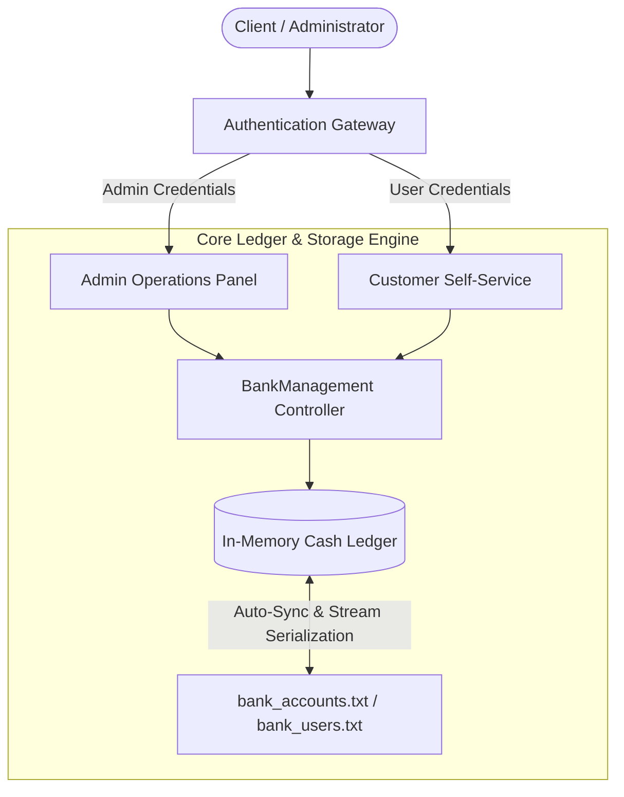

# 🏦 Enterprise Bank Management System (C++17)

> **High-Reliability Financial Transaction Engine**: Multi-Role Authentication, Disk-Persisted Accounts, Overdraw Safeguards, and Real-Time Ledger Audit.

---

## 🏛️ System Architecture



---

## 🌟 Key Capabilities

1. **Multi-Role RBAC (Role-Based Access Control)**:
   - **Administrator**: Create, edit, inspect, search, and delete accounts; list all system operators.
   - **Customer / Standard User**: Secure balance inquiry, deposit transactions, and guarded withdrawals.

2. **Persistent Storage Layer (`fstream`)**:
   - Zero-data-loss architecture: Hot writes on every deposit, withdrawal, or account modification.
   - Auto-recovery on application boot.

3. **Defensive Financial Integrity**:
   - Overdraw protection (`balance >= amount`).
   - Input sanitization against buffer overflows and type-mismatch loops.
   - Formatted currency precision (`fixed`, `setprecision(2)`).

4. **Automated Verification Harness (`--test`)**:
   - Built-in headless continuous integration suite validating account creation, balance updates, persistence reload, and overdraw defense.

---

## 🛠️ Build & Run

### Direct Build (g++)
```bash
g++ -std=c++17 -O2 main.cpp -o BankSystem
./BankSystem
```

### Automated Self-Test
```bash
./BankSystem --test
```

### CMake Build
```bash
mkdir build && cd build
cmake ..
cmake --build .
./BankSystem
```

